- 🛠️ **Co-Founder & Product/Technology Lead** at [Avizi](https://lightwonkas.github.io/avizi-showcase) — social platform for fishing & spearfishing communities
- 💼 Freelance software & product developer since 2022
- 🧠 Focus: full-stack products, LLM integration, AI agents, local-first infrastructure
- 🔧 Off-screen: custom automotive electronics, digital gauges, carbon fiber parts
- 📍 Istanbul, Türkiye · open to freelance & product collaborations

---

### 📊 GitHub at a glance

  
  

### 🧰 Skills

<table>
  <tr>
    <th align="left">Core stack</th>
    <th align="left">Backend & data</th>
    <th align="left">Tooling & infra</th>
  </tr>
  <tr>
    <td valign="top"></td>
    <td valign="top"></td>
    <td valign="top"></td>
  </tr>
</table>

### 🤖 Mobile, maps & AI

  
  
  
  
  
  
  

### 🚀 Notable projects

  
  

| Project | What it is | Stack |
|---|---|---|
| **[Argus](https://github.com/LightWonkas/argus)** | Always-on market & news monitoring with LLM-assisted decision support (equities, metals, crypto) | Python · FastAPI · React · TypeScript · SQLite · Docker |
| **Avizi** | Location-based social platform for anglers & spearfishers | React Native · Expo · Supabase · PostGIS |
| **In-car gauge system** | Custom digital gauges reading live vehicle data, carbon fiber housings | Embedded · Electronics · CAD |

---

Built with ☕ in Istanbul

